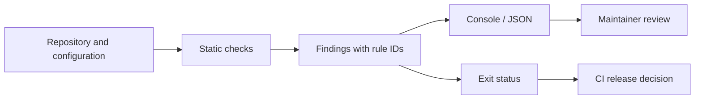

# Analytics Release Gate

**Help analytics engineers catch supported repository and Power BI project defects before release.**

**Business question:** Which detectable defects should block this analytics release, and which findings require human review?

> [!IMPORTANT]
> **Decision supported**
> A maintainer decides whether to block a release or investigate a finding using stable rule IDs, severity and console or JSON evidence.
> Exit `1` means blocking findings; `2` means input/configuration error; `3` means internal failure. Exit `0` means no FAIL findings, not proof of business correctness. Warnings, suppressions and manual checks still require review.

**Status:** v0.1 alpha. **Scope:** static repository checks. **External impact:** not yet measured.

[Source and reference documentation](https://github.com/GarethMackenzie/analytics-release-gate) · [Published package](https://pypi.org/project/analytics-release-gate/)

## Reproduce the audit

```sh
pip install analytics-release-gate==0.1.0
argate audit .
argate audit . --format json --output release-gate.json
```

Run from the repository under review. Retain its commit, tool version, configuration and exit status alongside the report. These commands audit the current directory; their results depend on its contents.

## See the result

| Capture | Composition | Caption |
|---|---|---|
| `docs/images/release-blocked.png` | Actual terminal run against a controlled defective fixture; visible rule ID and exit status | “Synthetic fixture; intentionally blocked release; tool version …” |
| `docs/images/release-review.png` | Same fixture after a documented repair; retain outstanding warnings | “Supported checks passed; manual review remains required.” |
| `docs/images/audit-report.png` | Real JSON output with sensitive paths redacted | “Machine-readable findings from commit …” |

<!-- Enable after capturing actual output:

-->



## Architectural decisions log

The following records summarize documented v0.1 boundaries retrospectively; they do not claim a new implementation or historical ADR approval.

| Decision | Chosen approach | Alternative not adopted | Cost accepted | Revisit trigger |
|---|---|---|---|---|
| Build execution | Do not execute arbitrary repository build commands | Execute builds directly during every audit | Generated-output drift remains a manual check | A sandboxed, resource-bounded build contract exists |
| Semantic validation | Conservative, documented DAX heuristics | Claim complete semantic validation from static text checks | False positives and undetected business errors remain possible | Labeled fixtures demonstrate an improved validator's precision and coverage |
| Exceptions | Explicit rule-ID exclusions | Silent auto-suppression | Exclusions can remove useful coverage and require review | External evaluations show a need for owner, reason and expiry metadata |

## What would prove value?

Evaluate release candidates against an independently adjudicated defect set. Report actionable precision, false-negative rate, review time, tool failures and escaped defects over a fixed observation window. Measure the cost of investigating false alarms. No reduction in defects or release time is claimed here.

## Boundaries

A successful audit does not verify source truth, business definitions, Power BI Desktop runtime behavior or complete credential safety.

## Engineering evidence

[Architecture and defensive programming](docs/engineering/ENGINEERING.md) · [External evaluation protocol](CASE_STUDY.md) · [Reusable README template](docs/engineering/README.template.md)

## Current rules

| Rule | Purpose | Default result |
|---|---|---|
| `REP001` | README exists | FAIL if missing |
| `REP002` | License exists | WARNING if missing |
| `REP003` | Tests detected | WARNING if missing |
| `REP004` | GitHub Actions workflow detected | WARNING if missing |
| `PBI001` | PBIP manifest parses | FAIL on invalid manifest |
| `PBI002` | PBIR JSON parses | FAIL on invalid JSON |
| `PBI003` | TMDL semantic model present for PBIP | FAIL if missing |
| `PBI004` | No machine-specific absolute paths | FAIL on match |
| `DAX001` | Suspicious hard-coded comparator heuristic | WARNING |
| `DAX002` | TMDL measure descriptions | WARNING |
| `SEC001` | High-confidence credential patterns | FAIL |
| `SEC002` | User home paths in tracked text | WARNING |
| `DOC001` | Local Markdown links resolve | WARNING |
| `BLD001` | Build/config entry point exists | WARNING |
| `BLD002` | Generated-output drift | MANUAL in v0.1 |

See [docs/rules.md](docs/rules.md) for semantics, limitations and examples.

## Configuration

Rules can be excluded in `pyproject.toml`:

```toml
[tool.analytics-release-gate]
exclude = ["DAX002"]
```

Rule suppression is explicit by ID so exceptions remain reviewable. See [docs/configuration.md](docs/configuration.md).

## Exit codes

| Code | Meaning |
|---:|---|
| `0` | Audit completed with no FAIL findings |
| `1` | One or more release-blocking FAIL findings |
| `2` | Invalid path or configuration/input error |
| `3` | Internal tool failure |

## What this tool does not do

Analytics Release Gate does **not**:

- prove that a business metric is factually correct;
- replace source/provenance review;
- execute arbitrary repository build commands in v0.1;
- claim that a PBIP project opens successfully in Power BI Desktop;
- replace secret-management or full static-analysis products.

These boundaries are deliberate. A green gate means the supported checks passed, not that the analytics product is universally correct.

## Development

```bash
python -m venv .venv
# activate the environment
pip install -e ".[dev]"
pytest
ruff check .
mypy src
```

See [CONTRIBUTING.md](CONTRIBUTING.md) for the contributor workflow.

## Roadmap

- v0.1: core CLI and first release rules
- v0.2: deeper DAX and semantic-model validation
- v0.3: configurable severity and richer suppression metadata
- v0.4: GitHub Actions annotations and Markdown reporting improvements
- v0.5: SARIF output
- v0.6: deterministic-build framework
- v0.7: plugin architecture
- v0.8+: governance rules informed by external users

## License

MIT. See [LICENSE](LICENSE).
